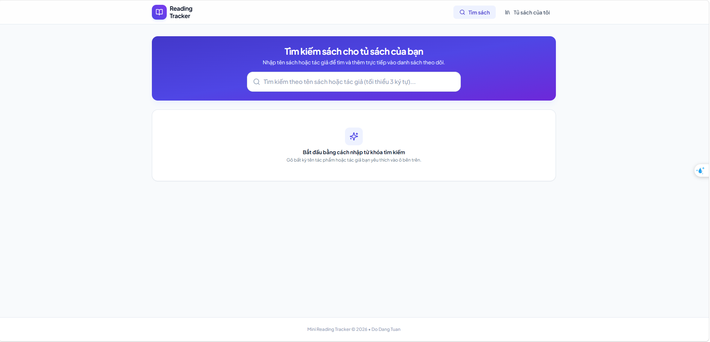
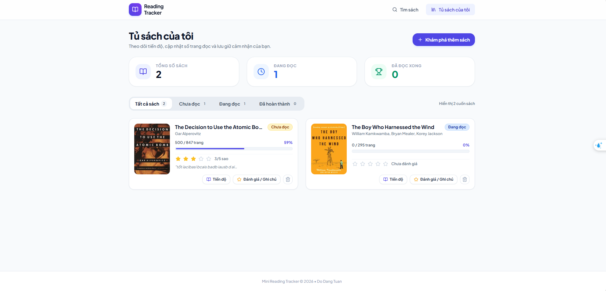
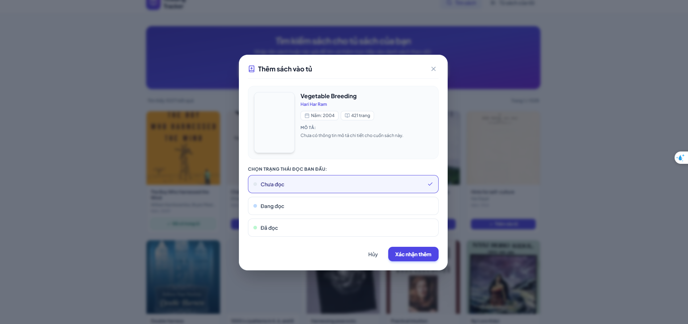
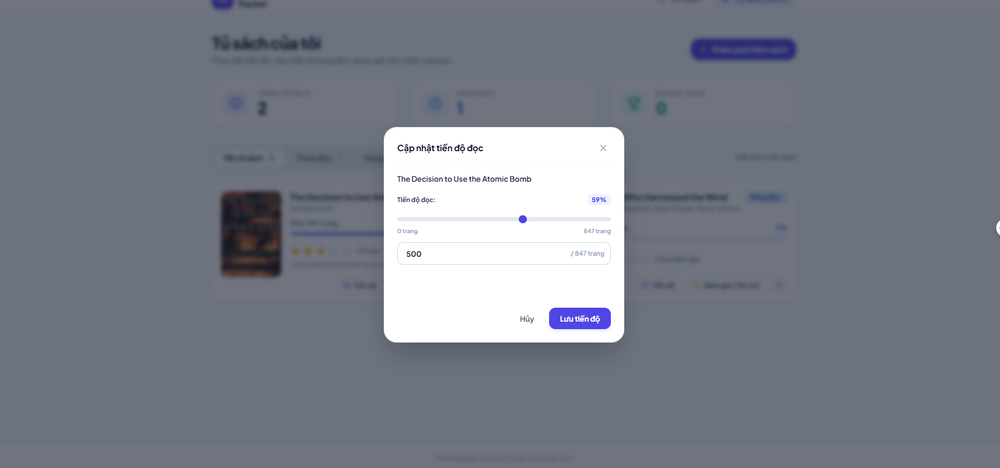
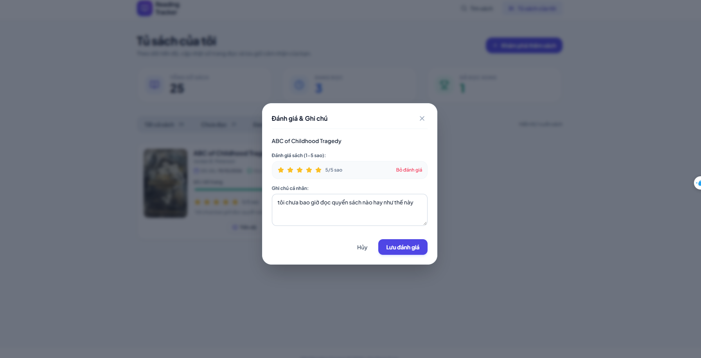
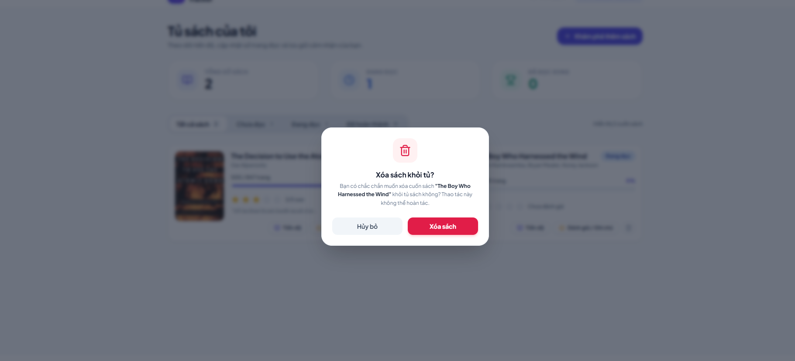
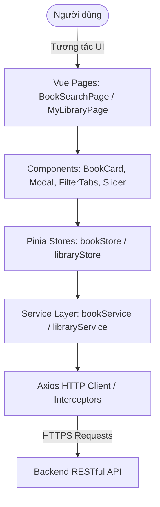

# Mini Reading Tracker - Frontend Application

> Ứng dụng Single Page Application (SPA) hiện đại hỗ trợ người dùng tìm kiếm sách từ kho dữ liệu Open Library, quản lý tủ sách cá nhân, theo dõi tiến độ đọc theo trang, đánh giá sao và lưu trữ ghi chú.

---

## 1. Giới thiệu ngắn & Ảnh chụp màn hình

**Mini Reading Tracker Frontend** được xây dựng với mục tiêu mang lại trải nghiệm tra cứu và quản lý sách mượt mà, trực quan:

- **Tìm kiếm sách nhanh chóng:** Tích hợp bộ tìm kiếm Open Library kèm debounce, phân trang thông minh, hiển thị đầy đủ ảnh bìa, tác giả, năm phát hành, số trang và chủ đề.
- **Quản lý Tủ sách trực quan:** Phân chia sách theo 3 trạng thái rõ ràng (_Chưa đọc_, _Đang đọc_, _Đã đọc_) kèm thống kê tổng quan (Tổng số sách, sách đang đọc, sách đã hoàn thành).
- **Cập nhật tiến độ tiện lợi:** Thanh trượt (slider range) kết hợp ô nhập số trang trực tiếp, tự động tính toán phần trăm hoàn thành và tự động chuyển trạng thái hoàn thành khi đọc hết 100% số trang.
- **Đánh giá & Ghi chú cá nhân:** Đánh giá sao tương tác (1 - 5 sao) và ghi chép cảm nhận của từng cuốn sách.

### Ảnh chụp màn hình / Demo

| Màn hình Tìm kiếm sách | Quản lý Tủ sách cá nhân  |
| :--------------------: | :----------------------: |
|  |  |

| Modal Chi tiết & Thêm vào tủ | Modal Cập nhật tiến độ đọc |
| :--------------------------: | :------------------------: |
|      |    |

| Modal Cập nhật Đánh giá  |  Modal Xoá khỏi tủ sách  |
| :----------------------: | :----------------------: |
|  |  |

---

## 2. Công nghệ sử dụng

- **Core & Framework:** [Vue.js 3](https://vuejs.org/) (Composition API, `<script setup>`, TypeScript)
- **Build Tool:** [Vite 6](https://vitejs.dev/) (Tốc độ khởi động siêu tốc và Hot Module Replacement - HMR)
- **State Management:** [Pinia](https://pinia.vuejs.org/) (Quản lý trạng thái phân tán cho Book Store, Library Store, Toast Store)
- **Routing:** [Vue Router 4](https://router.vuejs.org/) (HTML5 History Mode)
- **HTTP Client:** [Axios](https://axios-http.com/) (Service layer module hóa, bắt lỗi tập trung qua interceptors)
- **Styling & UI:** [Tailwind CSS 3](https://tailwindcss.com/) & [Autoprefixer](https://github.com/postcss/autoprefixer)
- **Icons:** [Lucide Vue Next](https://lucide.dev/) (Bộ icon hiện đại, sắc nét)
- **Kiểm tra kiểu dữ liệu:** [vue-tsc](https://github.com/vuejs/language-tools) & TypeScript 5.7+

---

## 3. Hướng dẫn chạy Local

### Yêu cầu tiên quyết

- **Node.js:** phiên bản `>= 20.x`
- **npm** (hoặc `pnpm`, `yarn`)
- **Backend API:** Khởi chạy backend tại local (`http://localhost:8000/api/v1`) hoặc sử dụng link production.

### Các bước cài đặt & khởi chạy

#### Bước 1: Di chuyển vào thư mục frontend và cài đặt dependencies

```bash
cd reading-tracker-fe
npm install
```

#### Bước 2: Cấu hình biến môi trường

Tạo file `.env.development` (hoặc `.env`) tại thư mục gốc của frontend:

```env
VITE_API_URL=http://localhost:8000/api/v1
```

#### Bước 3: Khởi chạy môi trường Development

```bash
npm run dev
```

Sau khi chạy thành công, truy cập ứng dụng tại:
👉 **Local URL:** `http://localhost:5173`

---

## 4. Mô tả kiến trúc & Sơ đồ Database

### 4.1. Kiến trúc Frontend (Component-Driven & Service-Oriented Architecture)

Frontend được phân tách trách nhiệm rõ ràng theo các tầng:

- **Views / Pages (`src/pages`):** Giao diện chính theo từng trang (`BookSearchPage`, `MyLibraryPage`).
- **Components (`src/components` & `src/pages/*/components`):** Tái sử dụng tối đa, chia nhỏ từ thẻ sách, thanh phân trang, modal, bộ lọc tab đến star rating.
- **State Store (`src/stores`):** Điều phối dữ liệu tập trung qua Pinia (`bookStore`, `libraryStore`, `toastStore`).
- **Services & Constants (`src/services`, `src/constants`):** Tầng giao tiếp API qua Axios và cấu hình endpoint, enum trạng thái đọc.



## 5. Danh sách API tích hợp

Toàn bộ các tác vụ trên Frontend giao tiếp trực tiếp qua RESTful API chuẩn:

- **Swagger Documentation:** `https://reading-tracker-be.onrender.com/api-docs` (hoặc `http://localhost:8000/api-docs`)
- **OpenAPI Schema (JSON):** `https://reading-tracker-be.onrender.com/api-docs.json`

### Bảng tóm tắt Endpoints:

| Phương thức | Endpoint              | Chức năng trên Frontend                                                         |
| :---------- | :-------------------- | :------------------------------------------------------------------------------ |
| `GET`       | `/api/v1/books`       | Tìm kiếm danh mục sách theo từ khóa từ Open Library                             |
| `GET`       | `/api/v1/library`     | Tải danh sách sách trong tủ cá nhân (hỗ trợ lọc theo trạng thái)                |
| `POST`      | `/api/v1/library`     | Thêm sách vào tủ cá nhân với trạng thái đọc khởi tạo                            |
| `PATCH`     | `/api/v1/library`     | Cập nhật tiến độ đọc (`currentPage`), đánh giá (`rating`) hoặc ghi chú (`note`) |
| `DELETE`    | `/api/v1/library/:id` | Xóa sách khỏi tủ cá nhân                                                        |

---

## 6. Mô tả cách đã Deploy

Frontend được triển khai trên nền tảng **Vercel** với quy trình tự động hóa CI/CD thông qua Git:

### Các bước thực hiện:

1. **Liên kết Repository:** Kết nối GitHub repository `reading-tracker-fe` với Dashboard của Vercel.
2. **Cấu hình Build Settings:**
   - **Framework Preset:** `Vite`
   - **Build Command:** `npm run build`
   - **Output Directory:** `dist`
   - **Install Command:** `npm install`
3. **Cấu hình Biến môi trường (Environment Variables):**
   - Thiết lập biến `VITE_API_URL` trỏ về domain HTTPS của Backend
4. **Cấu hình Rewrite cho Single Page Application (SPA):**
   - Đã tạo file `vercel.json` ở thư mục gốc để Vercel điều hướng toàn bộ request về `index.html`, tránh lỗi **404 Not Found** khi người dùng reload trang hoặc truy cập URL con trực tiếp:
     ```json
     {
       "rewrites": [
         {
           "source": "/(.*)",
           "destination": "/index.html"
         }
       ]
     }
     ```
5. **HTTPS & CDN Toàn cầu:** Vercel tự động cấp phát chứng chỉ SSL/TLS miễn phí và triển khai tài nguyên tĩnh qua hệ thống Edge Network/CDN.

---

## 7. Các giả định, hạn chế và hướng cải thiện

### 7.1. Giả định (Assumptions)

- Mỗi cuốn sách được định danh thống nhất bằng mã `id` (Open Library Work ID).
- Trải nghiệm được tối ưu cho một người dùng cá nhân (Single-user).

### 7.2. Hạn chế hiện tại (Limitations)

- Chưa có hệ thống tài khoản và phân quyền người dùng (chưa có màn hình Login / Register / JWT).
- Trạng thái đọc (`status`) hiện được hệ thống tự động suy diễn và gán dựa theo tiến độ số trang đang đọc (`currentPage = 0` là *Chưa đọc*, `0 < currentPage < totalPages` là *Đang đọc*, `currentPage = totalPages` là *Đã đọc*), người dùng chưa thể chủ động tùy biến hoặc chọn trạng thái đọc thủ công theo ý muốn độc lập với số trang.
- Tốc độ tải danh sách sách khi tìm kiếm phụ thuộc một phần vào độ trễ mạng và phản hồi từ API Open Library công cộng.
- Dữ liệu ảnh bìa từ Open Library có thể bị thiếu đối với một số tác phẩm hiếm (đã có ảnh placeholder dự phòng).

### 7.3. Hướng cải thiện nếu có thêm thời gian

1. **Tùy biến trạng thái đọc thủ công:** Cho phép người dùng chủ động lựa chọn và gán trạng thái đọc (_Chưa đọc_, _Đang đọc_, _Đã đọc_, _Tạm ngưng_, _Bỏ dở_) độc lập với số trang đọc hiện tại.
2. **Xác thực người dùng (Authentication):** Bổ sung màn hình đăng nhập / đăng ký qua Google OAuth2 hoặc Email/Password để mỗi người dùng có tủ sách riêng biệt.
3. **Offline Support & PWA:** Biến ứng dụng thành Progressive Web App (PWA) với Service Worker và IndexedDB, cho phép ghi nhận số trang đọc ngay cả khi không có kết nối Internet.
4. **Thống kê nâng cao & Gamification:**
   - Biểu đồ thống kê số trang đọc mỗi ngày/tuần/tháng (sử dụng Chart.js).
   - Thiết lập mục tiêu đọc sách hàng năm (Reading Goal Challenge).
   - Huy hiệu chúc mừng và hiệu ứng ăn mừng khi hoàn thành mục tiêu đọc.
5. **Tối ưu trải nghiệm đọc:** Ghi chép trích dẫn hay (Quote snippets), thêm ảnh chụp trang sách vào ghi chú.
